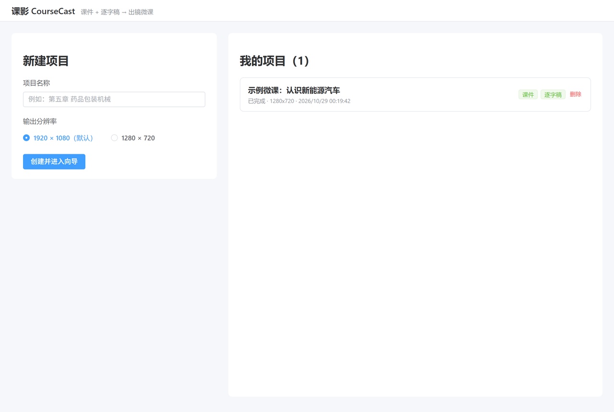
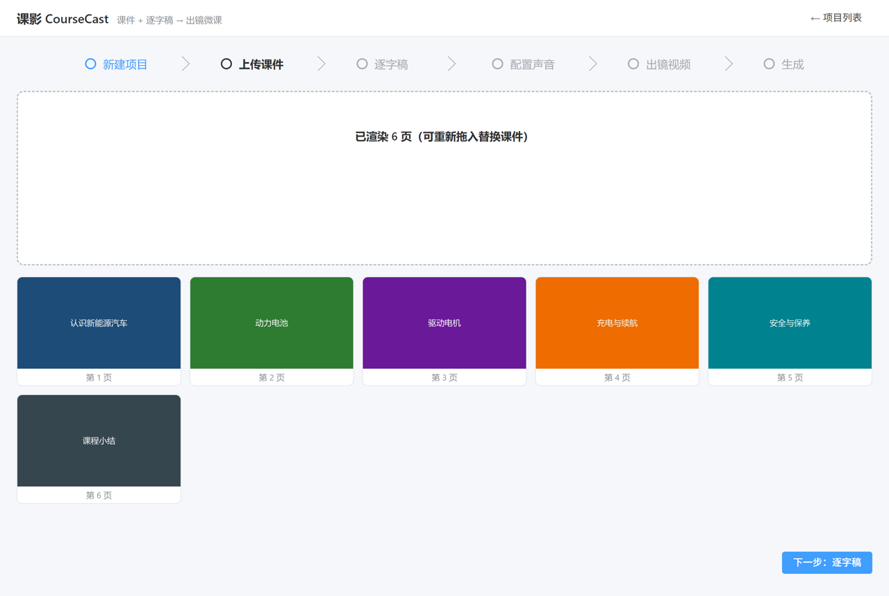
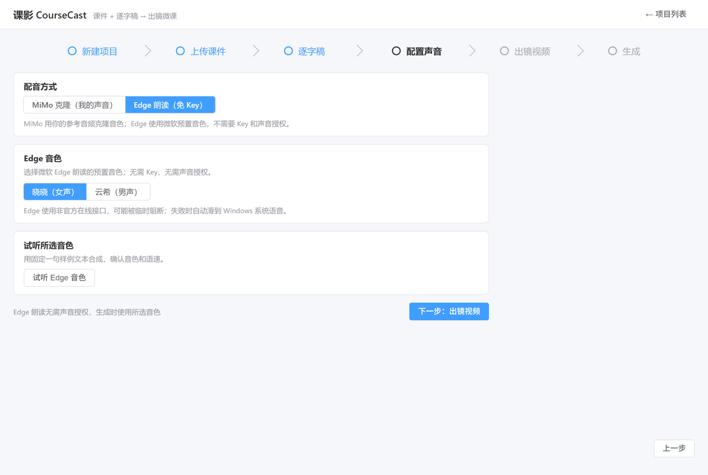

# 课影 CourseCast

把 PPT/PDF、逐字稿和一段出镜视频，自动合成为带讲解音轨、翻页对齐、人像画中画的课程视频。


课影是一个 Windows 桌面应用：选择课件、填入每页讲解稿、配置配音和出镜人像，就能在本地生成一门可以直接播放的微课视频。项目数据保存在本机，不依赖云端项目空间。

## 界面

> 截图取自真实 Tauri 窗口，使用合成演示课件与 Edge 音色，不含真实课程或声纹数据。

| 项目列表与新建项目 | 课件解析 |
|---|---|
|  |  |
| **配音配置** | **生成与自由版式** |
|  |  |

## 功能

- **六步向导**：新建项目 → 上传课件 → 逐字稿 → 配置声音 → 出镜视频 → 生成。
- **课件解析**：支持 PPT/PDF 或图片文件夹，自动渲染每页画面。
- **逐字稿**：直接粘贴并按页分隔，或导入 PPT 讲解备注。
- **三种配音路径**：
  - MiMo 声音克隆：上传参考音频并确认授权，使用你本人的音色；
  - Edge 朗读：免 Key，直接选择晓晓/云希等预置音色；
  - Windows SAPI：离线兜底，Edge 不可用时自动降级。
- **人像画中画**：RVM 抠像生成透明人像；也可以跳过抠像，使用白卡圆角卡片包住原视频。
- **自由版式**：拖动人像、调整位置和宽度，支持圆角/圆形与翻页动效。
- **可恢复生成**：课件、配音、时间轴、抠像、渲染分阶段执行；中断后只补未完成部分。
- **本地优先**：项目文件、素材和成片保存在本机；只有使用云配音时才会发送对应文本/参考音频。

## 项目状态

当前为 MVP：六步向导、本地出片、自由版式和人像兜底已可用；尚未提供公开的签名安装包，欢迎通过 issue/PR 反馈问题。

## 环境要求

| 项目 | 要求 |
|---|---|
| 操作系统 | Windows 10 / 11 x64 |
| WebView2 | 通常随 Windows 自带；缺失时安装 Microsoft Edge WebView2 Runtime |
| 磁盘空间 | 建议预留数 GB（课件、视频、模型与临时文件） |
| 内存 | 建议 8 GB 以上，抠像与渲染更吃 CPU/内存 |
| 配音网络 | MiMo 需要 API Key；Edge 朗读需要联网；SAPI 可离线 |
| 出镜视频 | MP4 / MOV 等常见格式；不提供出镜视频时可只用幻灯片 |

## 安装

当前仓库尚未提供公开的签名安装包。可以：

1. **从源码运行**：适合体验和开发，见下方“从源码运行”。
2. **构建 NSIS 安装包**：运行 `bash packaging/build-installer.sh`，产物位于 `target/release/bundle/nsis/CourseCast_*-setup.exe`。安装包未签名，Windows SmartScreen 可能提示风险。

## 快速开始

1. 启动 CourseCast，在首页点击“新建项目”，填写项目名称并选择输出分辨率。
2. 上传 PPT/PDF 或图片文件夹，等待课件页渲染完成。
3. 填写逐字稿：每页之间用 `---` 分隔，或从 PPT 备注导入。
4. 配置声音：
   - **MiMo 克隆**：粘贴 API Key、上传参考音频、勾选《声音授权确认》；
   - **Edge 朗读**：选择晓晓/云希，无需 Key 和声音授权。
5. 上传出镜视频；直接继续会使用白卡画中画，也可以先做抠像。
6. 在生成页调整人像位置/宽度和翻页动效，点击生成；成片在项目目录的 `output/final.mp4`。

## 从源码运行

### 前置工具

- Rust stable（MSVC toolchain）
- Node.js 20+ 与 npm
- Git Bash
- 完整 ffmpeg（含 `ffprobe`）在 PATH；开发/测试脚本会用到
- Windows 10/11 与 WebView2 Runtime

### 桌面开发

```bash
npm --prefix web ci
npm --prefix web run dev
cargo run -p cc-app
```

### CLI

```bash
cargo build --release -p cc-cli
./target/release/cc-cli.exe --help
```

CLI、MCP 与桌面应用共用 `cc-core` 的命令层，适合脚本或 AI 工具调用。

### 构建安装包

```bash
bash packaging/build-installer.sh
```

构建前置：

- Git Bash + winlibs MinGW（gcc / nasm / mingw32-make），用 `MINGW_BIN` 指向 MinGW 的 `bin` 目录或加入 PATH；
- 首次构建会联网下载 zlib/x264/ffmpeg 源码，并按脚本内钉死的 SHA-256 校验；
- 还需要 `vendor/` 下的 RVM 模型、pdfium，以及 `.venv` 中的 onnxruntime.dll（这些大文件不随仓库分发，路径见 `packaging/stage-resources.sh`）。

可先自检工具链：

```bash
bash packaging/build-ffmpeg.sh --check
```

### 测试

```bash
cargo test --workspace
```

低内存机器建议串行运行：

```bash
cargo test --workspace -j 1 -- --test-threads=1
```

前端类型检查与构建：

```bash
cd web
npx vue-tsc --noEmit
npm run build
```

## 数据与隐私

- 项目、素材和成片默认保存在本机应用数据目录；开发/测试可用 `CC_DATA_DIR` 指定其他目录。
- MiMo API Key 存入 Windows 凭据管理器，不写进项目文件或日志。
- 使用 **MiMo 克隆** 时，逐字稿文本和参考音频会发送给小米 MiMo API；使用 **Edge 朗读** 时，逐字稿会发送给微软 Edge 服务；**SAPI** 为本地离线合成。
- 出镜视频、课件和成片不会上传到配音服务。

## 常见问题

| 问题 | 处理 |
|---|---|
| MiMo 无法开始克隆 | 确认 API Key 已保存、参考音频已上传，并勾选《声音授权确认》。 |
| Edge 朗读失败 | Edge 使用非官方接口，可能临时被限制；检查网络，或改用 MiMo/SAPI。 |
| 生成时抠像很久 | 抠像是 CPU 推理，长视频较慢；可在第 5 步跳过抠像，使用白卡画中画。 |
| 安装包被 SmartScreen 拦截 | 当前安装包未签名，属于预期行为；只运行可信来源的构建产物。 |
| 页面图片不显示 | 检查项目数据目录权限；开发模式下项目需位于应用数据目录，assetProtocol 才能读取预览图。 |

## 已知限制

- 仅支持 Windows x64。
- 抠像和渲染依赖 CPU，性能取决于机器配置与素材长度。
- Edge 朗读依赖非官方接口，随时可能失效并自动降级到 SAPI。
- 当前没有公开的签名安装包；从源码构建的安装包未签名。
- 真人与克隆音色的效果取决于参考音频质量、授权和 TTS 服务稳定性。

## 参与开发

```text
crates/cc-core   共享命令层、阶段、指纹与领域逻辑
crates/cc-cli    命令行外壳
crates/cc-mcp    MCP 工具面
crates/cc-app    Tauri 2 + Vue 3 桌面壳
web/             Vue 3 六步向导
packaging/       最小 ffmpeg、资源汇编与 NSIS 安装包
screenshots/     README 界面截图
```

- 代码结构与协作约定见 `AGENTS.md`，领域术语见 `GLOSSARY.md`。
- 提交前建议运行：`cargo fmt --all -- --check`、`cargo clippy --workspace --all-targets`、`cargo test --workspace`，以及 `cd web && npx vue-tsc --noEmit && npm run build`。

## 许可

本项目原创代码以 **MIT** 发布，见根目录 `LICENSE`。安装包内包含的第三方组件仍按各自许可分发：

| 组件 | 许可 | 说明 |
|---|---|---|
| RVM 抠像模型 | GPL-3.0（权重同许可） | 分发含该模型的安装包时，按 GPL-3.0 提供源码或书面要约 |
| ffmpeg（含 libx264） | GPL-3.0 | 以独立进程调用，义务落在随包 ffmpeg 二进制 |
| pdfium / ONNX Runtime / Rust crates | Apache-2.0 / MIT / BSD 系 | 许可信息见 `packaging/SOURCE-OFFER.txt` |
| MiMo TTS | 云服务 | 走服务条款，不构成代码依赖 |
| Edge 朗读 | 非官方接口 | 可能随时被限制；失败时降级到 SAPI |

当前仓库只分发源码，不发布安装包二进制。若将来分发安装包，需要同时满足 GPL 第三方组件的源码/要约义务，并补齐发行方信息与第三方声明。
